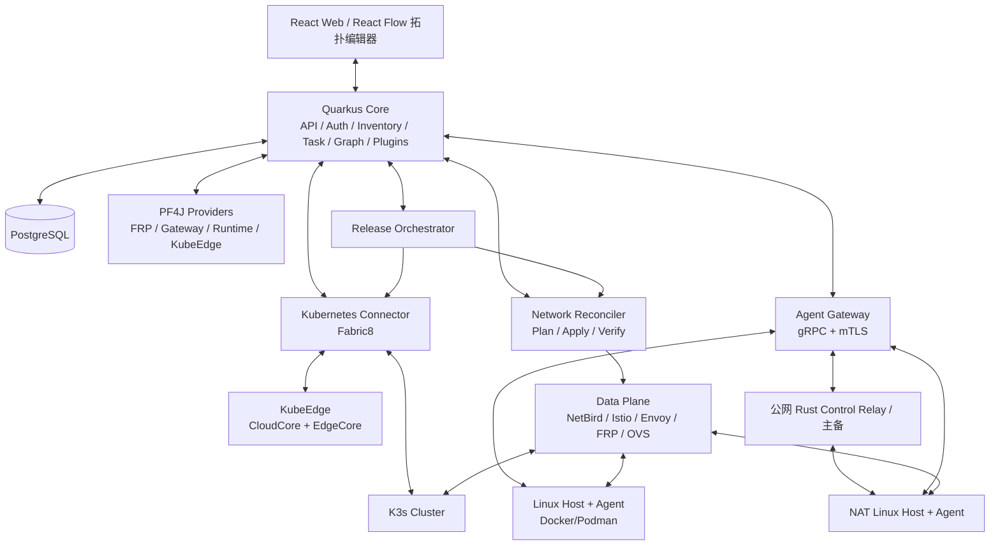

# NaNPanel 项目规划书

> **文档版本**：v0.2（权限边界与边缘 Rust 实现基线）  
> **编制日期**：2026-10-18  
> **项目定位**：Java 主控 + Rust 边缘执行的混合云基础设施控制面、跨 NAT 组网与可编程网络拓扑平台  
> **状态**：设计基线；所有性能数值与版本兼容性须通过 PoC 验证

## 1. 项目愿景与目标

本项目面向个人开发者、小型运维团队、家庭实验室及混合云场景，建设一个**不要求所有机器安装 Kubernetes** 的统一管理面板。用户可将公网 VPS、NAT/CGNAT 内的 Linux 主机、Docker/Podman 容器主机、K3s 集群及 KubeEdge 边缘节点纳入同一控制面，并以类似“插虚拟网线”的方式构造服务访问路径。

平台的核心价值不是重新实现 Kubernetes、WireGuard、FRP 或 Envoy，而是通过**统一资源模型、状态协调和插件兼容层**将它们组合成可视化、可执行、可回滚的基础设施。

### 1.1 核心目标

- **异构资产统一管理**：普通 Linux、Docker、Podman、K3s、KubeEdge 共用 Host / Service / Endpoint 等基础抽象。
- **跨 NAT/跨云互通**：在授权网络环境中优先直连，失败时通过加密 Relay；支持出站 TCP/443 的受限环境，但不承诺突破完全封锁的网络。
- **可执行拓扑**：图上的节点、端口、连线和策略被编译为设备配置，并能展示期望状态、实际状态和配置漂移。
- **插件化兼容**：FRP、Envoy、Nginx、Traefik、Open vSwitch 等由 Provider 插件发现、翻译、应用、验证配置。
- **现代部署能力**：滚动、蓝绿、金丝雀、健康验证和回滚；兼容 Kubernetes 工作负载和非 K8s 容器。
- **低占用与渐进启用**：核心最小化；Prometheus、OVS、Service Mesh 等高级组件按需部署。

### 1.2 明确的非目标（首个正式版本）

- 不自研完整 CNI、WireGuard 协议、STUN/TURN 或通用 L2 over WAN 协议。
- 不要求普通主机加入 K3s，不强制把跨地域节点做成同一个 etcd 集群。
- 不以完整多租户、计费系统、第三方插件市场、Windows 主机管理为首发目标。
- 不将拓扑线条直接视为已建成的网络；所有连接必须经过部署及探测确认。
- 不承诺所有 TCP/UDP 或任意二层协议都能在受限 TCP/443 代理中透明转发。

## 2. 架构设计原则

1. **Host 优先，K3s 可选**：主机是基本管理对象；集群与工作负载是附加能力。
2. **控制面与数据面分离**：Quarkus 不转发生产业务流量，由现成代理、隧道和交换组件转发。
3. **期望状态驱动**：核心存储 Desired State，Controller/Provider 通过 Reconcile 达成并报告 Observed State。
4. **插件不能绕过能力边界**：即使是自研插件，也只能通过受控 API 管理主机和网络。
5. **离线可生存**：控制面短暂离线不应中止已有业务流量；Agent 保留最后成功应用的有效配置。
6. **变更可恢复**：所有网络与发布操作具有版本号、幂等键、审计、超时及补偿步骤。
7. **先单体后拆分**：核心采用模块化单体；性能和故障隔离有证据后才独立部署服务。

## 3. 技术栈决策

| 层级 | 首选方案 | 可替换选项 | 采用原因 |
| --- | --- | --- | --- |
| 控制面 | Java 25（LTS）+ Quarkus JVM | Java 21 LTS；必要时拆分 Rust 进程控制器 | 复用 Java 技术积累，适合业务编排 |
| 动态业务插件 | PF4J + 自定义 Plugin SDK | gRPC 进程插件、OSGi | JVM 内热启停；复杂插件可进程隔离 |
| K8s 集成 | Fabric8 Kubernetes Client | Kubernetes Java Client | 管理 K3s/KubeEdge 对接的 K8s API |
| 主机 Agent 与自研边缘控制器 | Rust 独立二进制 | Rust 进程 / OCI 部署 | 统一边缘实现语言，不采用 Go 或 Java Agent |
| 特权执行 | Rust `privileged-helper`，以 root 身份运行 | 按能力进一步拆分受限 Helper | Agent 主进程非 root，仍支持系统级运维 |
| Agent 通信 | gRPC + Protobuf + mTLS | HTTP/2 长连接、WebSocket | 双向流、版本化协议、设备身份 |
| 组网 | NetBird / WireGuard（以 Adapter 集成） | Headscale/Tailscale、独立隧道服务 | 优先复用 NAT 穿透与中继能力 |
| 公网入口 | Envoy | Traefik、HAProxy、APISIX | L4/L7 路由与流量切分 |
| 传统穿透 | FRP Provider | 其他代理/隧道 Provider | 兼容既有部署和配置 |
| 虚拟网络设备 | Linux nftables + bridge；可选 OVS | tc/eBPF（后期） | 路由、NAT、交换、镜像依能力实现 |
| Kubernetes 发布 | Gateway API + Argo Rollouts | Flagger / 自研特定控制器 | 蓝绿与渐进式交付 |
| 非 K8s 发布 | Agent + Runtime Driver + Gateway | 后期自研轻量调度器 | 避免引入 K8s 依赖 |
| Web | React + TypeScript + React Flow | Vue 3 + Vue Flow | 自定义端口/拓扑连线与动态插件 UI |
| 数据库 | PostgreSQL + JSONB + Liquibase | SQLite（仅嵌入式实验版本） | 核心关系一致性、灵活插件字段、迁移 |
| 可观测性 | 轻量指标与日志，OpenTelemetry 接口 | Prometheus/Loki 按需 | 默认低占用 |

**取舍说明**：PF4J JAR 动态加载依赖 JVM；不要把承载 PF4J 的 Quarkus Core 编译成 Native Image。Agent 与 Core 是不同程序；自研 Agent、边缘控制器、运行时驱动和特权 Helper 统一使用 Rust，通过版本化协议对接 Java Core，不再将 Java Native 或 Go 列为边缘实现路线。Quarkus 动态 JAR 不会自动注册为构建期 CDI Bean/REST 端点；扩展必须通过平台 SDK、稳定 API 分发器显式注册。

## 4. 总体逻辑架构



### 4.1 职责边界

- **Core**：身份认证、资产和服务注册、期望状态、插件生命周期、任务与事件、API、审计。
- **Agent Gateway**：Core 内部身份、指令、会话与路由协调；独立 Rust Control Relay 接受 Core/Agent 出站双向流，支持受限 NAT 后的主控。详见 [ADR-011](docs/adr/ADR-011-control-relay-dns-failover.md)。
- **Host Agent**：系统状态、容器运行时驱动、网络配置执行、受限特权操作。
- **Kubernetes Connector**：集群发现、K8s 资源访问、控制器协调；不直接修改 K8s 托管容器。
- **Network Controller**：将拓扑意图编译成设备级配置计划，协调多 Provider。
- **Release Orchestrator**：发布策略、版本、检查、权重调整和补偿回滚。
- **Providers**：识别外部软件能力，读取/解析原配置，计算差异、部署与核验。

## 5. 资源与数据模型

### 5.1 核心实体

| 实体 | 关键字段 | 说明 |
| --- | --- | --- |
| `host` | id、hostname、os、arch、status、capabilities | 物理机/虚拟机的唯一平台身份 |
| `agent` | id、host_id、cert_identity、version、last_seen | 可与 SSH 模式共存 |
| `cluster` | id、type、endpoint、ownership、status | K3s / KubeEdge 所属 K8s 集群 |
| `cluster_node` | cluster_id、node_uid、host_id(nullable)、roles | K8s Node 不等同 Host |
| `container_runtime` | id、host_id、type、api_version | Docker / Podman 驱动实例 |
| `workload` | id、owner_type、owner_id、external_uid、version | Deployment、容器、systemd 服务 |
| `service` | id、name、protocol、owner、description | 逻辑服务，与实例生命周期分离 |
| `endpoint` | id、service_id、address、port、scheme | 实际访问端点 |
| `network_node` | id、kind、provider_id、attributes | Gateway、Router、Switch、Tap 等 |
| `network_port` | id、node_id、port_type、direction | 显式定义连接口能力 |
| `network_link` | id、source_port、target_port、transport、policy | 有类型的虚拟连接 |
| `route_policy` | id、matches、targets、weights、security | L4/L7 路由策略 |
| `topology_revision` | id、generation、author、snapshot、status | 拓扑版本和审计 |
| `deployment` | id、service_id、strategy、current_revision | 发布实体 |
| `operation` | id、idempotency_key、phase、status、error | 可恢复的异步任务 |
| `plugin_installation` | id、version、api_range、state、config | 插件状态与版本 |
| `observation` | resource_id、observed_generation、health、timestamp | 实际状态，不覆盖用户期望 |

初期以 PostgreSQL 的关系表维护唯一性和外键，特有配置放入有 Schema 校验的 `JSONB`；`network_link` 及 `topology_revision` 不直接以 React Flow UI JSON 为权威数据源。前端坐标、颜色、折叠状态单独保存。

### 5.2 状态收敛

`Desired State → Diff → ChangePlan → Validate → Prepare → Apply → Verify → Commit`。

失败时由补偿操作逐步恢复；跨主机变更不承诺全局原子事务。每个资源记录 `generation / observed_generation / conditions`，并对配置漂移发出告警。并发修改采用乐观锁或版本前置条件。

## 6. Agent 与主机管理

### 6.1 接入模式

- **Agentless（SSH）**：临时管理、初始化接入、恢复；能力受限，凭据必须加密并审计。
- **Managed Agent**：支持 Agent 主动连接主控、主控主动连接可达 Agent，以及双方各自出站连接公网主控代理；通道建立后均支持双方主动发送数据。双向 Relay 与 DNS 切换已有代码切片，真实 DNS 传播和故障场景仍需验收，见 [双向通道设计](docs/architecture/control-connectivity.md)。
- **Dual Mode**：Agent 故障时，在已配置的可信管理网络中可用 SSH 救援；不保证所有 NAT 场景可 SSH。

### 6.2 Agent 设计

- 自研 Agent 守护进程、边缘控制器、运行时驱动和 `privileged-helper` 统一使用 Rust；Core 内的编排、Agent Gateway 逻辑协调与 PF4J 插件仍使用 Java；独立公网 Control Relay 使用 Rust。
- Agent 主进程默认以专用普通用户运行，负责 mTLS 通信、任务校验、状态采集及本地状态持久化；系统级特权操作由独立的 root `privileged-helper` 通过受控本地 IPC 执行。
- 面向替代传统运维面板的需求，支持经授权的软件包安装、systemd 服务管理、防火墙与路由配置、受保护文件管理以及系统级容器管理；非 root Agent 不意味着仅能管理用户级资源。
- 只暴露明确的能力，例如 `systemd.read/restart`、`container.list/start`、`net.route.apply`、`file.read.managed`；不将任意 Shell 作为默认插件 API。
- 心跳、心跳序号、双向认证、断线退避、操作超时、幂等键、证书轮换、撤销和本地审计。
- 对影响 Agent 自身出口的变更采用“新路径验证后切换”和定时回退机制。
- 本地保存最后一次**已验证**配置及操作执行结果，断线时维持现有数据面。

### 6.3 系统运维权限与 Helper 边界

| 组件 | 运行身份 | 执行职责 |
| --- | --- | --- |
| Agent 主进程 | 专用普通用户 | Core 通信、任务接收、权限上下文传递、状态采集与结果上报 |
| 边缘控制器 / 运行时驱动 | 默认普通用户 | 本地协调、差异计算与验证；需要特权时调用 Helper |
| `privileged-helper` | root | 执行固定类型的系统服务、软件包、网络及文件操作 |
| 应用 / 容器 | 按工作负载配置 | 可为 rootful 或 rootless；与 Agent 自身运行身份独立 |

- Helper 默认仅监听本地 Unix Domain Socket，不开放远程 root RPC；由 root 管理 Socket 所在目录、访问权限和可执行文件，并校验连接进程身份。普通用户不得替换 Helper 程序或授权策略。
- Helper 接受类型化操作，例如 `service.restart(name)`、`package.install(packages)`、`firewall.apply(plan)`，而不是默认接受任意 Shell 字符串；调用系统工具时使用固定可执行路径和参数数组，验证选项及参数，不拼接 Shell 命令。
- Core 验证管理员会话并记录审计；Helper 验证本地调用者身份、固定操作类型和结构化参数。请求携带操作 ID、幂等键、版本条件和截止时间；操作范围由固定命令与参数验证定义，不依赖主机管理员逐项配置名单。
- 文件管理需限制允许目录、符号链接及路径穿越，避免校验后路径被替换；不得通过任意文件写入、安装脚本或开放容器 Socket 绕过能力边界。软件包操作仅允许配置的受信任源，并视为高权限变更。
- Helper 记录操作身份、目标、阶段和脱敏结果，限制超时、输出大小及并发。涉及网络出口的操作必须具备验证与定时回退机制，避免断开管理连接后无法恢复。
- 远程终端 / 任意命令执行不属于默认 Helper API；若后续支持，作为独立高权限能力显式授权、记录审计并设置会话与超时限制。
- rootful Docker/Podman 的系统级管理经受控驱动和 Helper 完成；rootless Podman 按工作负载所属用户执行，不假设 root 身份可以直接取得该用户的运行时上下文。
- MVP 先固定能力接口和权限上下文，纯逻辑实现可先在进程内验证；实际特权操作仍通过独立 Helper 落地。整个 Agent 以 root 运行不作为默认部署方案。

### 6.4 Rust 边缘实现边界

- `agent/` 规划为独立 Cargo workspace，覆盖 `daemon`、`runtime-drivers`、`privileged-helper`；`protocol/` 保留跨语言 Protobuf 契约，不依赖 Java 类序列化。
- 以后部署在被管理主机、边缘节点或公网入口上的自研控制器、Provider 执行进程均使用 Rust，经 gRPC / 受控本地 IPC 与主控或 Agent 通信；不能直接加载 PF4J JAR。
- `backend/` 中的 Java 模块属于主控系统，包括 Core 内部的 Network Reconciler、Fabric8 Connector 与 Agent Gateway。PF4J Provider 可在主控侧计划和协调，由 Rust 边缘执行端应用及验证本地配置。
- 本约束适用于本项目自研边缘组件，不要求重写或排除第三方 Envoy、FRP、NetBird、K3s、KubeEdge 等软件，也不限制被管理工作负载的语言。
- Rust Agent 仍须验证空闲资源占用、x86_64 / ARM64 兼容性、mTLS 重连、协议兼容和升级恢复；选择 Rust 本身不等于已经满足资源或安全目标。

### 6.5 运行时驱动

`RuntimeDriver` 统一容器列表、镜像、创建/删除、日志、健康、端口、资源限额等接口；Docker Driver 使用 Docker Engine API，Podman Driver 优先其原生能力并根据版本报告差异。不得假设 Docker 与 Podman 的网络或 API 完全等价；尤其应避免将 Docker Socket 暴露给普通插件。

## 7. 跨 NAT 组网与公网访问入口

### 7.1 双通道模型

- **管理通道**：Agent ⇄ Gateway 的 mTLS 通信，仅传控制消息、任务和受控日志。
- **业务通道**：NetBird/WireGuard/Relay、FRP、Envoy、路由器等组成真实数据面，独立于 Core 生存。

### 7.2 连接策略

1. 探测公网与 NAT 条件、已有路径和主机能力。
2. 优先合法的 UDP 直连 + WireGuard。
3. 直连失败时采用受信任 Relay；可允许 TCP/443 WebSocket 回退（取决于具体部署与出口策略）。
4. 记录 `DIRECT / RELAY / UNREACHABLE`、实际路径、时延、带宽和中继成本。
5. 若企业出口完全阻断外部服务、TLS 检查导致连接失败或需审批代理，明确报告无法连接，不绕过网络策略。

**边界**：NetBird 只是候选传输 Provider，不写死在领域模型中。部署前复核自托管能力、许可证、服务依赖与运维成本；默认不把 NAT 节点暴露在公网。穿透成功也不代表所有二层广播和 Kubernetes Pod 网络自动互通。

### 7.3 公网网关与非 K8s 入口

公网 VPS 可运行 Envoy / FRP Server / Relay。NAT 内普通 Linux 主机通过 Agent 管理本地 FRP Client、Docker、Podman 或 Gateway，承接流量并转发至 K3s Gateway API 的受控入口。可以用非 K8s 主机做入口，但不要求它成为 K8s Node。集群外访问应优先指向 Gateway/Service 公开端点，不能依赖可能变化的 Pod IP。

## 8. 可执行网络拓扑与虚拟设备

### 8.1 三种图层

- **基础设施层**：Host、Agent、Cluster、Node、NIC、Overlay Peer、网络出口。
- **连接与设备层**：Tunnel、Gateway、L3 Router、L2 Switch、Firewall、Packet Tap、Port 和 Link。
- **服务链路层**：域名 → 公网入口 → 代理/策略 → Service → Endpoint/Workload 的请求路径。

UI 使用 React Flow，节点拥有带类型的端口；“虚拟网线”可显示协议、方向、加密、带宽、延迟、丢包、运行状态。网络图展示**期望链路**与**经验证实际链路**的差异。未观测到真实业务调用时应标注“配置路径”，而非声称是已发现调用链。

### 8.2 可插拔网络设备

| 设备 | 可能的执行后端 | 限制 |
| --- | --- | --- |
| L4/L7 Gateway | Envoy / Traefik / HAProxy | 按协议决定可用匹配条件 |
| Router / NAT | Linux route + nftables | 需要宿主机网络操作权限 |
| Switch / Hub | Linux Bridge / Open vSwitch | 需要 L2 连接能力；考虑环路/广播 |
| Tunnel | NetBird / WireGuard / FRP | 由 Provider 声明传输与入站条件 |
| Packet Tap | OVS Mirror / tc / eBPF | 优先旁路镜像，注意敏感数据和开销 |
| Firewall | nftables / NetworkPolicy | 平台策略需转换为各后端语义 |
| Traffic Splitter | Envoy / Gateway API | HTTP 比例和 TCP 连接比例不等价 |

### 8.3 拓扑变更安全规则

- 连接前检查端口类型、L2/L3/L4/L7 协议兼容、权限、资源容量及是否会引入环路。
- 对断开管理通道、删除出口、重复 IP/端口、冲突路由等操作提供阻止或强制恢复策略。
- 修改网关采用生成新配置、语法检查、探活、原子替换/滚动切换的实现策略；不能保证所有 Provider 真正原子。
- 旁路抓包视为数据复制操作，而非默认内联中间设备；需要单独授权及保留策略。

## 9. 插件协议与兼容层

### 9.1 原则与运行时

主控侧自研插件以 PF4J JAR 交付，在运行时安装、启动、停止和卸载。插件持有的线程、定时器、路由、监听器和缓存必须主动释放，ClassLoader 卸载不等于立即回收内存。高权限或长时间运行的设备控制器可以使用独立进程 / OCI + gRPC Provider，避免阻塞主 JVM；部署在边缘的自研控制器统一使用 Rust，系统特权操作仍经本地 Helper 执行。

插件标准扩展点建议为：

- `HostCapabilityProvider`
- `ContainerRuntimeProvider`
- `ClusterProvider`（K3s / KubeEdge）
- `NetworkProvider`（FRP / NetBird / OVS / 网关）
- `ConfigTranslator`
- `ReleaseProvider`
- `TelemetryProvider`
- `UiContributionProvider`

### 9.2 Provider 生命周期接口（概念）

```java
interface NetworkProvider {
    ProviderDescriptor descriptor();
    DiscoveryResult discover(ProviderContext context);
    CapabilitySet capabilities();
    ChangePlan plan(NetworkGraph desired, NetworkGraph observed);
    ValidationResult validate(ChangePlan plan);
    OperationId apply(ChangePlan plan);
    VerificationResult verify(OperationId operation);
    CompensationResult compensate(OperationId operation);
}
```

正式实现将按异步 API 设计取消、超时、版本条件、幂等和部分失败语义；`compensate` 不等于保证完全回滚。

### 9.3 插件清单示例（自定义格式）

```yaml
id: provider.frp
name: FRP Provider
version: 0.1.0
apiVersion: panel.io/plugins/v1
runtime: pf4j
requiresCore: '>=0.1.0 <1.0.0'
capabilities:
  - config.discover
  - route.tcp
  - route.http
  - config.validate
  - config.apply
permissions:
  - agent.service.read
  - agent.service.restart:frpc
  - agent.file.manage:/etc/frp/
ui:
  menu: /plugins/frp
```

这是本平台拟定的清单协议，并非 PF4J 或 FRP 的官方 Manifest。核心负责校验签名/哈希、版本依赖、权限和迁移；已安装插件禁用后保留配置与业务数据，删除时需明确数据策略。

### 9.4 FRP 兼容层完整流程

1. `Discover`：通过 Agent 识别 FRP 版本、配置文件、实际进程和代理状态。
2. `Normalize`：将 FRP 的 `localIP/localPort/remotePort` 等转换成 Service/Endpoint/Route；保留无法无损转换的原始字段。
3. `Plan`：根据图的新版本计算配置差异，并标记平台托管与用户托管的字段。
4. `Validate`：检查 FRP 配置、版本特性、端口占用和管理通道安全。
5. `Apply`：优先仅更新受管代理配置，调用适用的 FRP 重载能力。
6. `Verify`：同时检查 FRP 状态、监听与公网端到端探测；失败执行补偿。

FRP 的 `frpc reload` 可以更新代理相关配置，但不能无条件热更全部公共参数；Provider 必须准确报告 `HOT_RELOAD / RESTART_REQUIRED / UNSUPPORTED`。严禁盲目覆盖未知字段和用户手工编辑。

### 9.5 前端插件

由 Core 返回经过认证的菜单、路由、权限和 UI 扩展描述；简单页面优先 Schema 驱动。复杂页面可加载随插件交付的静态前端 Bundle，但需版本约束、构建签名、内容安全策略。动态 JS 与主页面同源时不具备真正安全沙箱，首期仅接受自己发布的插件。

## 10. K3s 与 KubeEdge 管理

### 10.1 K3s

- 支持导入已运行集群，以及通过 Agent 安装/升级/诊断 K3s。
- Kubernetes 资源由 Fabric8 通过 API Server 管理，节点 OS 层由 Agent 管理。
- 一套控制面管理多个独立 K3s 集群，**优先采用多集群互联而非跨地域单集群 etcd**。
- 管理 Pod/Service/Ingress/Gateway/Storage/CRD 时保留 K8s RBAC 约束和资源所有权。
- 集群网络通道与管理隧道解耦：K3s CNI 仍需满足底层 MTU、路由、节点间通信要求。

### 10.2 KubeEdge

- CloudCore/EdgeCore 使用其官方安装与控制机制管理，不复写其核心组件。
- Host Agent 可与 EdgeCore 共存，用于 OS、网络和日志诊断；**不得同时争抢 EdgeCore 所有的容器状态**。
- KubeEdge CloudHub/EdgeHub 属于云边控制同步，不自动提供完整 Pod 业务网络；CNI 与跨站点服务通信分别由对应组件负责。
- KubeEdge Provider 负责节点注册、版本、证书、组件健康、离线自治状态与可达入口；EdgeMesh 作为可选网络插件，不与主 Overlay 同时接管同一路径。

## 11. 发布编排：滚动、蓝绿、灰度

统一抽象为 `Release -> Revision -> TargetGroup -> TrafficPolicy -> Analysis -> Promotion / Rollback`。

| 模式 | K3s/KubeEdge 的 Kubernetes 工作负载 | 普通 Docker/Podman 主机 |
| --- | --- | --- |
| 滚动 | Deployment / Rollout | 按 Host 批次替换，保留最低可用副本 |
| 蓝绿 | Argo Rollouts Active/Preview Service | 两组实例，Gateway 切换 |
| 金丝雀 | Rollouts + 支持的 Gateway 路由控制器 | Envoy 等代理按请求/连接分流 |
| 健康验证 | Readiness + Metrics/Analysis | Agent 健康检查 + Gateway 指标 |
| 回滚 | 版本/路由回退 | 切回前一组实例/代理路由 |

**重要约束**：若由 Argo Rollouts 接管路由，平台 Release Provider 应调用/协调它，不能与自己的 Network Reconciler 同时改写同一个 HTTPRoute。Gateway API 的 `backendRefs.weight` 是相对权重，不承诺每时每刻恰好符合请求百分比。数据库 Schema 变更的兼容性需要应用级策略，恢复旧容器并不一定能回滚数据库。

## 12. 安全与权限

Web HTTP 契约见 [OpenAPI](api/openapi.yaml) 与 [Web 平台 API](api/web-platform.md)：Cookie 会话 + CSRF、登录与本人会话、管理员账号、内置角色、仪表盘、非机密设置和持久化审计已实现。首期角色仅 ADMIN，可管理多个管理员账号；不包含公开注册、自定义角色或多租户。Core 不再接受 Basic 认证；Agent mTLS 身份校验已实现，证书吊销/轮换、多实例共享限流和完整泄露密码库仍待实现。

- **最小权限**：初期可只有管理员角色；除预认证 CSRF 与登录流程外，业务 API 强制认证；为未来 RBAC 留下 `subject/action/resource` 授权接口。
- **设备身份**：Agent 一次性注册码 + mTLS 独立证书；支持吊销、轮换、重放保护。
- **K8s 访问**：区分集群凭据，按最小 RBAC 原则分配权限；不默认用 `cluster-admin` 执行全部操作。
- **插件隔离**：权限由 Core/Agent Gateway 执行，不依靠 PF4J ClassLoader 实现安全隔离。
- **主机权限**：普通用户 Rust Agent + root Rust Helper；受控本地 IPC、管理员访问控制、固定操作类型、参数和路径校验；禁止通过任意 Shell、文件写入或开放 Docker Socket 绕过授权。
- **机密管理**：数据库中加密凭据/令牌；脱敏日志；插件仅取得短期操作凭证或代理访问能力。
- **网络安全**：管理面与业务入口分开；默认拒绝未经授权的公网暴露；高风险变更有确认和恢复计划。
- **供应链**：插件包哈希/签名、SBOM、依赖审计、软件许可证台账；第三方网络组件商用/自托管条款上线前复核。

## 13. 控制面部署与资源目标

**MVP 部署方式**：单个 Quarkus Core（JVM）+ PostgreSQL，可运行在被管理集群之外；Web 静态资源可由反代分发。NetBird、Envoy、FRP、OVS、监控系统按需部署，不计为“核心进程自身”的内存。

**待测的工程目标（不是现有实测承诺）**：

- 核心独立运行，无 Redis/Kafka/RabbitMQ/Prometheus 强制依赖。
- 测试环境首先覆盖 20 Host、2 集群、100 Service、500 条图边；再扩展到 100 Host 压力测试。
- Agent 空闲 RSS 与 CPU 在目标 x86_64/ARM64 设备上分别测量；以实测结果优化 Rust 实现与可选功能，不再将 JVM Native/Go 作为 Agent 路线。
- UI 对 500 条图边仍保持可编辑；需要节点折叠、懒加载及批量状态更新。
- 控制面重启后可根据持久化 `operation` 与 `generation` 恢复未完成变更。
- 业务数据面不因为单次 Core 重启而停止现有的健康路由；Relay 中断属于另一故障域，需要冗余设计。

## 14. 项目目录建议

```text
hybrid-infrastructure-platform/
├── README.md
├── PROJECT_PLAN.md
├── docs/
│   ├── architecture/
│   ├── adr/
│   ├── protocols/
│   ├── security/
│   └── testing/
├── backend/
│   ├── panel-core/             # Quarkus 启动、Auth、REST
│   ├── panel-domain/           # Host/Service/Graph/Release 模型
│   ├── panel-plugin-api/       # 版本化 Provider SDK
│   ├── panel-plugin-runtime/   # PF4J 生命周期
│   ├── panel-agent-gateway/    # gRPC 连接、任务
│   ├── panel-network/          # 规则编译与状态协调
│   ├── panel-cluster/          # Fabric8 Connector
│   └── panel-persistence/      # PostgreSQL / Liquibase
├── agent/
│   ├── protocol/
│   ├── Cargo.toml              # 已建立的 Rust workspace
│   ├── daemon/                 # Rust 普通用户 Agent
│   ├── runtime-drivers/        # Rust Docker/Podman 驱动
│   └── privileged-helper/     # Rust root Helper，受控本地 IPC
├── plugins/
│   ├── provider-frp/
│   ├── provider-envoy/
│   ├── provider-netbird/
│   ├── provider-kubeedge/
│   └── provider-ovs/
├── web/                        # React + TS + React Flow
├── api/                        # OpenAPI / Protobuf / JSON Schema
├── deploy/                     # Compose / systemd / Helm
└── tests/                      # 单测、契约、集成、网络故障实验
```

## 15. 实施计划与阶段验收

> 不预设开发完成日期；每阶段达成可复现的验收门槛后推进下一阶段，避免单人项目过早铺开。

### P0｜架构可行性验证

- [x] 创建 Quarkus + PF4J 动态加载/卸载 PoC，验证卸载后任务及引用清理。
- [x] 验证 Rust Agent gRPC mTLS 在隔离容器网络中建立出站长连接、断线自动恢复。
- [x] 验证普通用户 Agent → root Rust Helper 的本地 IPC：允许操作成功，未授权能力、路径逃逸、符号链接及非可信调用方被拒绝。
- [x] 在隔离 rootless Podman 实验中封锁两端 eth0 的 UDP 入/出站，验证 NetBird peer 通过 TCP/443 Relay 建立连接并访问 overlay HTTP 服务。
- [x] 验证 FRP 原配置导入 → 差异 → 应用 → 验证 → 补偿。
- [x] 跑通 React Flow 图编辑器到单条实际服务路由的隔离实验闭环。
- [x] 在真实 NAT Docker 主机与 `k3s-1` 间封锁双方 Peer 的 UDP 入/出站，验证 NetBird TCP/443 Relay 及 K3s 工作负载 HTTP 响应。
- [x] 通过 React Flow 拓扑应用更新真实 NAT Docker 主机上的 FRP 配置，从公网 VPS 经 HTTPS 实际访问 `k3s-1` 上的 Service。

**验收**：公网 VPS、NAT Docker 主机、K3s 服务之间经受控网关完成 HTTP 访问；修改拓扑后能看到实际路由同步及连通性证据。已通过真实 HTTPS/FRP 拓扑闭环和跨主机 UDP 受限 NetBird Relay 验证，详细边界与命令见 [P0 验收说明](tests/p0/README.md)。

**当前门槛**：P0 阶段验收已完成。各单项隔离组件 PoC 均通过；`k3s-1` 的真实 Service 经 SSH 隧道和公网 VPS → NAT Docker 主机 → K3s 的 React Flow/FRP 链路均有 HTTP 证据。NetBird 0.75.1 的 Docker 主机 Peer 与 K3s 工作负载 Peer 在双方 eth0 UDP 入/出站受阻时均报告 Relay，且 overlay HTTP 请求返回 K3s 测试内容。公网测试通过 `--resolve` 和临时 Host 映射验证指定 VPS IP，不代表 DNS 传播验收。

### P1｜基础管理 MVP

- [x] Host/Agent/Operation 实体和数据库迁移（systemd 观测及通用操作字段迁移已补齐）。
- [x] 单管理员认证、Agent mTLS 身份、审计日志与结果未知记录。
- [x] Rust Agent：Linux 主机信息、systemd 服务观测；systemd unit 重启已接入 Core → Gateway → Agent → root Helper。
- [x] Rust Agent：systemd 重启的跨进程本地持久化去重与结果确认/重放。
- [x] Rust Agent：通过固定 systemd unit 校验进行有界 journal 查询，结果进入持久化操作日志并回执确认。
- [x] SSH 固定只读可达性探测：主机 UUID 绑定 root-managed alias，强制固定 known_hosts、BatchMode 和 true 命令，不保存私钥或密码。
- [x] SSH 救援恢复：对 已确认 host key 的资产 SSH 配置提交固定 systemctl restart/active 校验，操作幂等、审计并将断线结果标为 UNKNOWN；默认无授权 unit。
- [x] P1 固定范围的 agentless SSH 管理/恢复代码：资产 SSH 探测、systemd 状态/有界日志读取与重启，以及固定安装脚本初始化 Agent。
- [x] 主机资产 SSH 直连配置：支持地址、端口、用户名、密码或私钥；凭据 AES-256-GCM 加密，host key 未核对并显式信任前不发送认证信息。
- [x] SSH 直连可省略 alias 执行固定 Agent 安装脚本；一次性接入码仅经 SSH stdin 传递，需以首次 mTLS 心跳确认结果。
- [x] 管理员显式开启 PTY 堡垒 Shell：一次性 WebSocket 票据绑定当前 Web 会话；会话、已提交命令行和终端输入/输出录像单独存储，命令及录像加密、有界并按保留期清理。
- [ ] 在两台非 K3s Linux 主机上验收真实 SSH 通道、拒绝路径和恢复流程。
- [ ] 在真实目标机验收堡垒终端交互、会话撤销、命令历史/录像回放、数据清理与主机账户权限边界。
- [x] Agent 侧恢复基元：1–8 个 HTTPS 端点规范化轮询、有限退避，以及系统 DNS 失败后的 Cloudflare A/AAAA 直查（UDP 截断回退 TCP、受限重试、公网地址过滤）。
- [x] ADR-011 代码切片：Core/Agent 双向拨号、双 Relay 预连接、安装时 Ed25519 签名故障切换端点清单、Cloudflare DNS 单写租约/写后读回、Relay 三次健康/失败滞回、120 秒切换冷却和周期性 API 对账。
- [ ] 在 Cloudflare 测试 Zone 验证 TTL/公共解析恢复，并完成限制型 NAT、Relay 故障与 Core 掉线场景验收。
- [x] Rust root Helper：软件包安装、受保护文件原子写入、临时 nftables 规则及 30–300 秒可验证 systemd 定时回滚已接入异步 Operation；每条操作由固定能力和参数校验约束，不读取逐项操作名单；每条网络规则限定接口/协议/端口，`CAP_NET_ADMIN` 仅授予瞬时 worker。
- [x] Docker/Podman 容器列表、日志、启停和受限部署已接入类型化 Helper Operation；真实宿主机验收待完成。

**阶段边界**：systemd 与通用 Helper 服务链有数据库集成测试，覆盖操作幂等键重放、结果回调去重、未知结果审计、有限行数的 journal 查询、临时防火墙规则验证/定时回滚，以及 Agent 本地日志跨重启恢复。Helper 不读取逐项权限名单；软件包、systemd、容器、文件和网络操作使用固定类型、格式校验与运行约束。SSH 固定探测、systemd 操作和 Agent 初始化使用资产直连凭据及已确认 host key；堡垒命令/录像使用 AES-GCM 密文，管理员可显式开启受审计 PTY Shell；Shell 的实际命令能力由资产配置的 SSH 主机账户权限决定，不通过 Agent/Helper 授权。Agent 安装 token 经 SSH stdin 传递并等待首次 mTLS 心跳，断线或无心跳时结果未知。两台非 K3s 主机的 SSH 拒绝/恢复流程及真实终端/录像验收仍未完成。ADR-011 已有 Agent 端点轮询、受限 DNS 直查、Rust 双向 Relay 流、Core 数据库单调 epoch、Relay 持久 fencing 和 Core Gateway 多 Relay 出站和数据库 leader 租约代码、Agent 双 Relay 同时预连接代码，签名故障切换端点清单由 Core Ed25519 签发并由 Agent 本地校验；Cloudflare DNS 三次健康/失败滞回、120 秒切换冷却和 API 周期读回对账已有代码；TTL/公共 DNS 传播验证、限制型 NAT/代理故障真实验收仍未完成。因此 P1 尚未通过整体验收。真实环境步骤和证据要求见 [P1 验收手册](tests/p1/README.md)。

**验收**：无 K3s 的两台 Linux 主机可独立被管理；非 root Agent 可通过 Helper 完成授权的系统级运维，越权请求被拒绝并记录审计；断网重连后的任务幂等和状态恢复正确。

### P2｜组网与公网入口

- [x] Agent 可选读取 NetBird 本机状态，持久化并展示逐 peer 的 Relay/P2P 路径。
- [x] NetBird managed-group Overlay Provider：PF4J 装载、带前缀所有权的 peer membership observe/plan/validate/apply/verify/compensate、Core 操作状态持久化和审计；真实 disposable tenant 的成员协调、重启恢复与补偿已通过[验收](tests/p2/runs/2026-10-20-netbird-provider-live.md)。
- [x] 测试环境 FRP 公网入口：HTTPS/TLS、Basic Auth、后端切换与补偿；Core 管理的生产 Gateway Provider 仍未实现，见 [P2 入口验收记录](tests/p2/runs/2026-10-20-frp-public-ingress.md)。
- [x] `panel-cluster` 提供 namespace 限定、只读、带界限的 Kubernetes Service/EndpointSlice 发现适配器。
- [x] Core 暴露默认关闭、服务器端固定 cluster/namespace 的服务清单 API，并在拓扑页展示 Live/Mock 来源及 EndpointSlice 就绪信息。
- [x] Core 服务库存 API、最新快照持久化、业务 Endpoint 映射和 EndpointSlice 就绪状态。
- [x] 可选启用的有界 Ready EndpointSlice 私网 TCP 探测及结果持久化。
- [x] Core 到测试/目标集群的服务探测验收：2026-10-20 13:42 UTC 使用受限只读 API key 验证库存快照和 SUCCEEDED TCP/8080 探测时间匹配；Istio HTTP allow/deny 仍是独立 fixture 证据，见 [live run](tests/p2/runs/2026-10-20-core-service-probe-live.md)。
- [x] 为后续 Kubernetes workload Provider 接入 Istio 建立隔离测试网格并写入 ADR；见 [Istio 服务网络架构](docs/architecture/service-network.md)。

**验收**：至少两种 NAT 条件、直连/中继切换、Gateway 变更恢复经测试；其中 FRP 公网测试入口的 Gateway 后端切换与补偿已通过。公有主机路径已通过 P2P→Relay→P2P；私网接口 rwt-dev 已通过 P2P→Relay→P2P、每阶段 HTTP 及临时控制/Relay 重启恢复；同一公网 IP 反射服务确认其公网出口与测试主机不同。Core 管理的生产 Gateway Provider 协调仍开放。

**当前实现**：Agent 可选读取仅监听 loopback 的 NetBird metrics，把已知、连接、P2P 和 Relay 数量作为有时效的主机汇总显示；若 root Helper 检测到可信 NetBird CLI，还会读取并脱敏 `netbird status --json`，将逐 peer 名称、状态、P2P/Relay 类型和观测时间经 Core 展示在控制台。另有首个 PF4J NetBird Provider，只协调 `nanpanel-managed-` 前缀专属分组的 peer membership；Core 将计划和阶段持久化至数据库并审计，Provider 在应用、恢复与补偿时校验漂移，保留既有 group resources。该功能有本地 HTTP fixture 覆盖，并已在 disposable tenant 中通过真实 peer 成员协调、Provider 重启恢复及补偿；它不管理 peer enrollment、NetBird policies 或路由。`panel-cluster` 的 namespace 限定 Service/EndpointSlice 适配器已接入 Core：后台每 60 秒采集并持久化最新快照，拓扑页展示服务端口、EndpointSlice 地址、就绪状态、Pod 身份和观测时间；独立的默认关闭探测开关支持每轮最多 32 个 Ready 私网 TCP 端口探测，持久化最新结果并保留七天，并在 2026-10-20 13:42 UTC 的 authenticated live API run 中对 Ready non-injected mesh-probe-target 成功执行 TCP/8080 探测，持久化了与 inventory 快照匹配的 SUCCEEDED 记录；受限 API 密钥功能已实现并部署，Core inventory/probe live API 验收已于 2026-10-20 13:42 UTC 通过。K3s 清单为 Core 配置独立 ServiceAccount；Istio fixture 的限域 RBAC 已在测试集群应用，实时权限检查为 Service/EndpointSlice list yes、Pod list/Secret get no；当前测试 Core 已运行 GHCR 镜像 sha-2ccc15845f956e61f6356871f3750bbdf383afb9，使用 nanpanel-core ServiceAccount，发现和探测均已启用；Core 侧持久化探测证据见 [live run](tests/p2/runs/2026-10-20-core-service-probe-live.md)。Istio HTTP allow/deny 是独立 fixture 证据，strict-mTLS fixture 旁另有独立的 non-injected TCP 探测目标；当前测试集群已验证其 Ready 私网 EndpointSlice，Istio policy Provider 仍未实现。`tests/p2/frp-public-ingress.sh` 已在真实测试公网 Nginx/FRPS 路径验收系统信任的 TLS 证书、未授权 401、授权 Basic Auth、后端 A→B→A 补偿及活动配置哈希；报告见[入口验收记录](tests/p2/runs/2026-10-20-frp-public-ingress.md)。`tests/p2/netbird-path-switch.sh` 在 2026-10-20 已于一个公有主机 Docker→K3s 拓扑通过 P2P→Relay→P2P，每个阶段均有 HTTP 探测，并验证一次性 NetBird 控制/Relay 服务重启后的连接和 HTTP 恢复；同一路径在 10:46 UTC 复验通过，报告见 [成功路径切换记录](tests/p2/runs/2026-10-20-netbird-successful-path-switch.md)和[复验记录](tests/p2/runs/2026-10-20-netbird-successful-path-switch-rerun.md)。另一次尝试从 `hk-81x` NAT 候选连接控制面时 TCP/443 超时，未进入路径和 HTTP 验收；报告见[诊断记录](tests/p2/runs/2026-10-20-netbird-hk-nat-control-timeout.md)。rwt-dev 私网接口主机在 11:20 UTC 通过 P2P→Relay→P2P、每阶段 HTTP 和临时控制/Relay 重启恢复，出口与测试主机不同；报告见[第二网络路径切换记录](tests/p2/runs/2026-10-20-netbird-rwt-path-switch.md)；Core 管理的生产 Gateway Provider 仍未实现。

**边界**：Istio 只负责 Kubernetes 工作负载间身份、mTLS 与流量策略，不替代普通主机/跨 NAT 的 NetBird Overlay。`nanpanel` 控制面暂不自动注入 Istio。Core 已在目标集群持久化与 Ready EndpointSlice 对应的 SUCCEEDED TCP 探测；inventory 历史仍未实现；Core-to-cluster API 验收已于 2026-10-20 13:42 UTC 通过受限 API key live run。Core 管理的生产 Gateway Provider 保持开放，属于后续协调能力；公共 FRP 测试入口只验证测试路由，不提供生产配置协调。逐 peer Agent 观测属于只读库存，不是 Provider reconciliation。隔离网格和单一网络路径切换实验都不能单独代表 P2 阶段完成。具体证据矩阵见 [P2 验收手册](tests/p2/README.md)。

### P3｜拓扑与插件协议

- [x] NetworkGraph、类型化端口与连线、持久化 Topology Revision。
- [x] Provider 启停生命周期、Capability、Config Translator 和通用 Core 操作协议。
- [x] FRP TCP Provider 计划/校验/应用/验证/补偿及路由漂移检测。
- [x] UI 区分待部署/已验证/异常/不可支持的链路。

**验收**：新增 Provider JAR 可由 PF4J 在不修改 Core 业务代码的情况下装载；停用时 Core 阻断仍有未终结操作的插件，且 FRP 插件停用/启用不改写未托管配置。证据和边界见 [P3 验收记录](tests/p3/README.md)。FRP 插件当前要求 Core 可直接访问本机 TOML 文件、FRPC CLI 和固定 HTTP 探测端点；远程 Agent 配置传输、生产 Gateway 协调和 topology-to-provider 自动编排仍未实现。

### P4｜K3s / KubeEdge

持久化逐节点升级计划已部署至目标 `k3s-1`（commit `6f146e3`）；镜像摘要、服务健康及部署边界见[部署记录](tests/p4/runs/2026-10-21-k3s-rollout-plan-deployment.md)。这只验证计划 API/UI 所在版本已运行，不代表已执行真实 K3s 升级或通过多节点故障恢复验收。

- [x] 拓扑文件夹支持多层编辑（本机浏览器场景已覆盖）。
- [x] 在目标 K3s 环境读取 Namespace、Ingress 路由、Service、Pod 及容器端口/状态；见 [真实 K3s API 与拓扑视图验收](tests/p4/runs/2026-10-21-k3s-target-api-smoke.md)。
- [x] 服务网络只显示真实 Kubernetes 与 Istio 数据：Service/EndpointSlice、Envoy sidecar 就绪状态、Envoy 请求计数/HTTP 响应/mTLS 标签；Mock 模式不生成网络数据，服务和端点按需展开。已部署并完成 `k3s-1` UI/API 实测，2026-10-22 再次从目标真实 Core API 显示 Istio LIVE、3/3 sidecar 和 HTTP 200/403 mTLS 流量。提交 `d69b2b4` 的 Web 镜像增加页面可见时 30 秒快照轮询和分别标识过期清单/遥测；提交 `fbf151f` 将拓扑、Istio 服务网络和 Provider 配置拆成独立工作区，部署后分别检查路由视图与实时 Service/Endpoint/Envoy 200/403 mTLS 数据，拓扑写入为 0。见 [Istio 服务网络实测](tests/p4/runs/2026-10-22-k3s-istio-service-network-live.md)、[部署后路由与 Istio UI 复验](tests/p4/runs/2026-10-22-k3s-route-istio-ui-live.md)、[拓扑与 Istio 新鲜度 UI 部署](tests/p4/runs/2026-10-22-topology-istio-freshness-deployment.md)和[本地路由保存 UI 回归](tests/p4/runs/2026-10-22-topology-route-save-ui.md)。
- [x] Agent 自动探测安装主机上的 kubelet/K3s 并按 Host 保存发现记录；目标 `k3s-1` 实时记录与当前部署复核见[部署记录](tests/p4/runs/2026-10-21-agent-kubernetes-runtime-discovery-deployment.md)。
- [x] 同集群 Agent 自动纳管实现与现有目标集群认领：Core 使用集群内只读 ServiceAccount，不导出或持久化 kubeconfig/token，并按 `kube-system` UID 和 Kubernetes Service IP 去重；`k3s-1` 已实测认领既有导入集群。隔离 Core 集成测试通过有证书指纹校验的 `/internal/agent-heartbeats` 覆盖无导入记录时新建、既有指纹认领、NotReady 重试、重复心跳、临时 API 503 重试及错误证书拒绝（拒绝前不写发现记录），见[自动纳管验收](tests/p4/runs/2026-10-22-kubernetes-auto-enrollment.md)。
- [ ] 自动纳管实机边界：目标环境尚未从空集群导入状态完成实时新建和 API 故障恢复验收；远程 Agent 的安全凭据签发/更新流程也未实现。当前目标 Core 与 Agent 同处 `k3s-1`，不能把本地隔离 API 测试当作远程纳管证据。
- [x] 在真实 `k3s-1` Agent 路由上验收下一跳匹配：浏览器通过正常“添加主机资产”流程读取真实路由，并显示 `k3s-1 → 自动发现 Router 10.0.0.1`、React Flow 观测边及 Gateway 主机资产绑定；部署后复验仍通过，服务网络显示真实 Istio 数据且拓扑写入为 0。见[路由与 Istio UI 实测](tests/p4/runs/2026-10-22-k3s-route-istio-ui-live.md)和[部署后复验](tests/p4/runs/2026-10-22-topology-istio-freshness-deployment.md)。
- [ ] 在目标生产拓扑中保存并重新加载 Host/Gateway 资产及观察到的路由边。目标拓扑草稿尚未写入；本地保存/重载与卡片无重叠回归通过，但不替代目标持久化证据，见[路由保存 UI 回归](tests/p4/runs/2026-10-22-topology-route-save-ui.md)。
- [x] 在目标 K3s 上完成单集群导入、Node UID 映射及 namespace 限定 Deployment 创建/列表/缩放/删除，见 [真实 K3s API 验收](tests/p4/runs/2026-10-21-k3s-target-api-smoke.md)。
- [x] Core 的 K3s Node 映射状态机通过隔离 API 回归：同一 Host 的重复映射被拒绝，Node 移除后保留 tombstone，显式解除映射后 Host 可重新分配；该证据不代表真实多节点运行时，见[K3s Node 映射代码验收](tests/p4/runs/2026-10-22-k3s-node-mapping-code.md)。
- [x] 在目标 `k3s-1` 与隔离 K3s API 间验收集群隔离和跨集群资源拒绝：真实目标集群参与双集群导入，隔离集群完成 Deployment 创建/列表/缩放/删除；跨集群资源 ID、未拥有资源删除及错误凭据被拒绝。见[混合集群 API 验收](tests/p4/runs/2026-10-21-k3s-target-multi-cluster-api.md)。这项不以本机 Kind 测试代替目标集群证据。
- [ ] 在目标环境验收多个真实 Node 的映射冲突及 Node 移除/解除映射。当前唯一目标 `k3s-1` 是单节点集群；本机 Kind 或无 kubelet 的隔离 K3s API fixture 不计入真实多节点运行时验收。
- [x] K3s 安装与升级的类型化 Helper/Core 代码路径：固定版本/校验和、目标主机准入、持久化计划、单节点 Server 安装步骤、幂等重放及失败/UNKNOWN 停止行为已有隔离代码测试；单节点安装计划成功后等待集群导入和 Ready Node 主机映射，不会派发 Agent。见[安装计划代码验收](tests/p4/runs/k3s-installation-plan-code.md)、[升级计划代码验收](tests/p4/runs/k3s-rollout-plan-code.md)和[单主机 Helper 能力记录](tests/p4/runs/2026-10-21-k3s-install-helper-capability.md)。
- [x] Core 在 K3s API 不可用时仍提供缓存的 Host 路由诊断，并拒绝 Agent 接管 Kubernetes 管理的容器；隔离 Core 集成测试验证 API `UNAVAILABLE`、路由查询成功、容器操作 `409 KUBERNETES_CONTAINER_OWNED` 且没有创建操作记录。该测试不模拟目标 API 断连，见[K3s API 故障与主机诊断](tests/p4/runs/2026-10-22-k3s-api-failure-host-diagnostics.md)。
- [ ] K3s 实机安装、升级前校验及失败恢复：尚无真实安装/升级恢复或实际 Core 进程重启验收。唯一目标 `k3s-1` 是已管理的运行中单节点集群，不在其上执行首次安装或破坏性升级；本轮按用户选择跳过实时 `k3s.preflight`。本机 rootless Podman 的 K3s fixture 预检因 cpuset cgroup 未委派而未启动，见[fixture 预检记录](tests/p4/runs/2026-10-22-rootless-k3s-fixture-preflight.md)。
- [x] Core 提供 KubeEdge CloudCore/EdgeCore 状态观测和 Host/Node 所有权保护；隔离集成测试覆盖缓存 EdgeCore systemd 状态及 Kubernetes API 不可用时保留 Host 诊断，见[KubeEdge EdgeCore 状态验收](tests/p4/runs/2026-10-21-kubeedge-edgecore-process-observation.md)。
- [ ] KubeEdge Provider 生命周期与注册管理：独立 `ClusterProvider` SPI、PF4J 装载、plugin 状态枚举、Core 只读快照观察 API，以及持久化生命周期计划/幂等重放/generation 漂移拒绝/恢复后验证接口已实现并部署到唯一目标 `k3s-1`；034 迁移和 Core 健康检查已验收。`kubeedge-core` 对新鲜健康快照中的 `NOT_OBSERVED` CloudCore 生成恢复校验安装计划；对新鲜健康且 CloudCore `HEALTHY` 的快照，现增加 EdgeCore 加入计划：要求 Host 资产、可达 CloudCore `host:port` 和 `EDGECORE_BOOTSTRAP_TOKEN` 凭据引用，Core 校验用途/作用域/状态以及 Host 尚未映射到当前集群 Node，并仅持久化非秘密参数与 opaque UUID。隔离 Core API 测试覆盖合法计划持久化/恢复验证、凭据用途不匹配拒绝、已映射 Node 的 Host 冲突拒绝及秘密不泄漏。新增单步执行入口：仅对已验证的 `kubeedge-core` EdgeCore 加入计划重新检查 generation、Provider 计划、主机和 scoped token 凭据后解密，并通过稳定幂等键派发到指定 Host Helper；Host Operation ID 持久化到 Provider 计划，Core 重启后按该 ID 对账。计划状态包含 `EXECUTING`、`AWAITING_NODE_REGISTRATION`、`SUCCEEDED`、`FAILED` 和 `UNKNOWN`；Helper 成功后仍等待最新快照里的同名 Ready Edge Node 显式映射到目标 Host，Helper 失败和不确定结果分别保留失败/未知状态。通用 Host Helper API 禁止直接调用该能力，Helper 仅在发现 root-owned `keadm` 且 systemd 可用时报告能力，并使用固定 argv 执行官方 `keadm join`，结果不回显 token。Java 定向 API 回归和 Rust 全套检查覆盖参数拒绝、凭据/计划边界及类型化能力；没有 KubeEdge 目标，因此不代表 `keadm join`、Edge Node 注册、自动映射或失败补偿已实机验收；自动映射、补偿、崩溃恢复和远程凭据签发/轮换仍未实现。新增并已部署 035 凭据表和 KubeEdge 凭据元数据/写入/撤销 API；秘密使用 Kubernetes credential key 做 AES-GCM 加密并绑定 Provider、集群及凭据 UUID，创建/撤销要求 5 分钟内重新认证，API 不提供秘密读取。Core 解密入口拒绝作用域不符、过期或撤销凭据。当前管理员会话未能登录，线上 Provider 清单和认证凭据 CRUD 尚未验收；没有 KubeEdge 目标。Core、Agent 和 Helper 执行代码已随 `92d8654` 发布并更新至 `k3s-1`，镜像、服务健康和未执行 KubeEdge 操作的边界见[EdgeCore Helper 派发部署验收](tests/p4/runs/2026-10-22-kubeedge-edgecore-helper-dispatch-deployment.md)；部署不代表已执行 `keadm join` 或完成 KubeEdge 实机验收。见[Provider 边界记录](plugins/provider-kubeedge/README.md)、[凭据托管代码与部署验收](tests/p4/runs/2026-10-22-kubeedge-provider-credential-vault.md)、[EdgeCore 计划代码验收](tests/p4/runs/2026-10-22-kubeedge-edgecore-join-plan.md)、[EdgeCore Helper 派发代码验收](tests/p4/runs/2026-10-22-kubeedge-edgecore-helper-dispatch-code.md)、[EdgeCore 执行状态对账代码验收](tests/p4/runs/2026-10-22-kubeedge-execution-reconciliation-code.md)、[CloudCore 计划 Provider 代码验收](tests/p4/runs/2026-10-22-kubeedge-cloudcore-plan-provider.md)、[CloudCore 计划 Provider 部署验收](tests/p4/runs/2026-10-22-kubeedge-cloudcore-plan-provider-deployment.md)、[SPI 部署记录](tests/p4/runs/2026-10-22-cluster-provider-spi-deployment.md)、[快照 API 部署记录](tests/p4/runs/2026-10-22-cluster-provider-snapshot-deployment.md)、[计划持久化与验证记录](tests/p4/runs/2026-10-22-cluster-provider-plan-validation.md)和[计划 API 部署记录](tests/p4/runs/2026-10-22-cluster-provider-plan-deployment.md)。
- [x] 普通 Linux Gateway 为 Ready K3s Service 提供入口，并验证 TLS、访问控制及回滚；见 [目标 K3s Gateway 入口验收](tests/p4/runs/2026-10-21-linux-gateway-k3s-service-ingress.md)。拓扑到远程 Gateway 的自动协调仍未实现。

**验收**：K3s API 故障时，Host Agent 仍能诊断宿主机；不会让 Agent 与 KubeEdge 双重管理容器。

**当前实现边界**：Agent/Helper 提供类型化 `k3s.preflight` 只读检查、`k3s.install` 单主机首次安装和 `k3s.upgrade` 单主机升级能力。Core 提供持久化 K3s 多节点升级计划和多节点首次安装计划。升级计划在启动时刷新并检查集群成员、Host 映射、Agent/Helper 状态和版本兼容性，按 Server 后 Agent 排序，通过稳定幂等键一次推进一个节点；每步成功后要求所有 Node Ready、原 Host 映射仍在且 `kubeletVersion` 与目标版本一致。首次安装计划显式启动后先安装 Server，等待管理员导入 K3s 集群并把 Ready Server Node 映射到指定 Host，然后才逐台加入 Agent；每台 Agent 必须在集群 API 中成为指定版本的 Ready Node 并映射到原 Host 后才推进下一步。安装短令牌以 Kubernetes credential key 进行计划绑定的 AES-GCM 加密，计划读取响应和审计记录不返回令牌。2026-10-22 隔离 Core 测试覆盖安装 Server 操作终态 `UNKNOWN` 时停止计划、阻止 Agent 下发并清除加密令牌；升级计划测试覆盖操作终态 `UNKNOWN` 时停止计划且不下发后续 Agent 步骤。两种计划的自动推进、远端 Agent 失败/UNKNOWN 对账、Core 重启恢复及 API 中断仍缺隔离多节点 K3s 端到端验证，不在生产 `k3s-1` 执行首次安装或破坏性升级，详见[安装计划](tests/p4/runs/k3s-installation-plan-code.md)和[升级计划](tests/p4/runs/k3s-rollout-plan-code.md)测试记录。Agent 会扫描本机 kubelet/K3s 进程和 systemd 服务并在心跳中报告。启用 `NANPANEL_KUBERNETES_AUTO_ENROLL_LOCAL_ENABLED` 后，若报告来自 K3s API Server，Core 会使用本身的集群内身份确认同名 Ready Node 后自动登记集群并映射触发发现的 Host；自动集群凭据源是只读 Core ServiceAccount，数据库不保存副本，并以 `kube-system` Namespace UID 去重。此路径仅适用于 Agent 所在 K3s 集群与 Core 当前集群相同；远程 Agent 的安全凭据获取和轮换仍未实现，其他发现记录仍显示为候选而非已纳管集群。安装/升级都限定固定稳定版本并校验官方 release checksum；安装拒绝覆盖已有数据，并将令牌只写入 root 可读 systemd 环境文件。升级仅支持由 NaNPanel 固定 unit 管理的节点、拒绝降级和跨越一个 Kubernetes minor 以上的升级，并在节点健康检查失败时尝试恢复旧二进制。Core 对单主机升级仍要求目标 Node 存在且 Ready、集群最近 120 秒内健康，并串行化同集群安装/升级；每次操作终结后必须先刷新集群观测。Server 操作等待本地 Ready Node，Agent 操作仍要求后续确认 Node Ready。KubeEdge 集群摘要可读 CloudCore Pod 就绪情况；Node 清单以 Edge 角色标签、Node 存在性和 Ready 条件派生 EdgeCore 注册状态，并将已映射 Host Agent 最近的 `edgecore.service` systemd 观测合并为独立进程状态，过期观测不会显示为健康。该状态来自缓存观测而非同步进程探测。KubeEdge 安装注册流程和拓扑到远程 Gateway 的自动协调仍未完成；对应清单保持未勾选。

升级计划另有单节点 fake Agent Gateway 覆盖：Core 从持久化 `SUBMITTING` 状态重放时，按原幂等键关联已有 Helper 操作，避免向 Agent 重复 dispatch。该隔离测试不代表实际 Core 进程重启或目标 K3s 升级恢复；记录见[升级计划代码验收](tests/p4/runs/k3s-rollout-plan-code.md)。

Agent Kubernetes runtime discovery 的代码测试和 `k3s-1` 部署证据见[部署记录](tests/p4/runs/2026-10-21-agent-kubernetes-runtime-discovery-deployment.md)。

多节点 K3s 首次安装计划已合入并推送 `main`（commit `f6c373c2fbf2f45bf88dcfec17c1a5249495e6e4`），CI 验证和 Core/Web GHCR 发布通过。指定的 1ms Registry 代理现已成功拉取公开 Core 镜像；私有 Web 镜像无法从代理访问，但目标节点已有同一不可变 GHCR 发布镜像缓存。部署脚本已完成 Core/Web 更新，迁移 `032-k3s-installation-plans` 已应用，Agent 已同步，服务与发现状态复核正常。详见[目标发布与恢复记录](tests/p4/runs/2026-10-21-k3s-installation-plan-deploy.md)。

### P5｜高级发布

- [ ] K3s 上的 Gateway API + Argo Rollouts 对接。
- [ ] Docker/Podman 的蓝绿与分批发布。
- [ ] HTTP 金丝雀权重、指标门槛、自动/人工回滚。

**验收**：灰度过程可观测、可暂停；模拟异常能恢复旧路由，且有审计和结果验证。

### P6｜可编程虚拟设备

- [ ] OVS/Bridge/Router/Firewall/Packet Tap Provider。
- [ ] 虚拟网线链路指标、端口能力与 L2/L3 校验。
- [ ] 更丰富的设备插入、镜像、拓扑版本比较与回放。

**验收**：证明实际网络规则生效，不把“画出连线”当作设备已联通；可证明错误配置不会永久切断管理通道。

## 16. 测试矩阵与故障演练

| 场景 | 验证项 |
| --- | --- |
| 公网 VPS + 家用 NAT | 直连/中继路径、重连、入口访问 |
| 对称 NAT / UDP 阻断 | TCP/443 Relay 与性能退化提示 |
| 普通 Docker 主机 | 容器生命周期、端口映射、日志与权限 |
| 普通 Podman 主机 | rootful/rootless 差异、用户上下文、网络兼容、资源能力判断 |
| 普通用户 Agent + root Helper | IPC 身份校验、操作级授权、参数/路径限制、审计、超时与越权拒绝 |
| Rust 边缘 x86_64 / ARM64 | 构建运行、资源占用、协议兼容、升级失败恢复 |
| 单节点 K3s / 多节点 K3s | 资源管理、Service/Gateway、升级前检查 |
| KubeEdge 离线边缘 | Cloud/Edge 状态、边缘自治、重连同步 |
| FRP 外部修改配置 | 不覆盖用户未知字段，能提示配置漂移 |
| 网络拓扑错误 | 环路/冲突/切断 Agent 路径的防护 |
| Provider 停止/升级 | 新任务阻断、在途任务清理、数据保留 |
| 网关/Relay/Core 故障 | 流量影响范围、恢复时间、日志证据 |
| 发布中断/部分失败 | 幂等、补偿、旧版本可用、审计链 |

测试工具可使用 Linux network namespace、`tc netem`、容器网络实验环境及受控的云端节点；避免在生产网络直接模拟丢包和断线。

## 17. 主要风险与缓解

| 风险 | 影响 | 缓解策略 |
| --- | --- | --- |
| 功能范围过大 | 开发长期无法闭环 | 每期给出真实可测试端到端成果 |
| Rust 边缘组件资源占用或跨架构兼容不达标 | 小型 VPS 难以使用或升级失败 | 实测 x86_64 / ARM64 的 RSS、CPU 与安装升级，按需启用驱动和控制器 |
| 跨 NAT 传输不可用 | 节点无法组网 | Relay 可选、能力探测、清晰报错 |
| 配置模型转换不完整 | 覆盖原有 FRP/代理设置 | 保留原始字段，声明部分托管、冲突拒绝 |
| 逻辑拓扑与真实网络不一致 | 误导排错和运维 | Desired/Observed 双层、探测与漂移状态 |
| 多编排器争抢同一资源 | 发布和网络规则反复被改写 | 明确资源 Owner / Field Manager |
| 插件泄漏或崩溃 | 控制面不稳定 | 生命周期清理、超时、重型插件进程隔离 |
| Agent 或 root Helper 被滥用 | 宿主机安全风险 | Agent 非 root、mTLS、本地 IPC 校验、操作级授权、Helper 固定操作验证及审计 |
| 第三方组件许可证变化 | 发布受限制 | 版本锁定、许可台账、上线前法务复核 |

## 18. 首个验证原型的“完成定义”

**实验资产**：

- `VPS-A`：公网，运行 Core、PostgreSQL、一个 Public Gateway/Relay。
- `HOST-B`：NAT 内普通 Linux，运行 Rust Agent + Rust root Helper + Docker + FRP Client。
- `K3S-C`：可通过受控网络访问的 K3s 集群，部署 `demo-web:v1` 和 `demo-web:v2`。

**演示流程**：

1. 在面板注册 HOST-B 和 K3S-C，自动识别节点能力。
2. UI 将 `公网 Gateway → FRP/Tunnel → HOST-B → K3s Gateway → demo-web` 绘成服务链路。
3. 点击“部署拓扑”，由 Provider 生成/校验/应用配置；只有端到端验证成功后连线才显示 Healthy。
4. 在图上更换端口，查看差异计划并完成无损更新；验证旧配置可以恢复。
5. 使用灰度控件将 v2 流量从 0 调整至 10%、50%，再切换至 100%；显示实际请求统计而非只显示目标权重。
6. 人为阻断 UDP 或关闭一个链路，确认中继切换/错误告警；关闭 Core 验证数据面仍保持原路由。
7. 停用 FRP Provider，证明 Core 保持可用且不会误删现有路由/外部配置。

**通过条件**：能从拓扑配置到真实流量完成闭环；支持回滚与审计；在断线、应用失败和控制面重启时具备可解释的恢复状态。

## 19. 架构决策记录（ADR）

- `ADR-001`：Quarkus JVM + PF4J，而不是 Core Native Image。
- `ADR-002`：控制面与数据面分离；K3s 不作平台强制依赖。
- `ADR-003`：Host、ClusterNode、Workload、Service 各自拥有独立身份。
- `ADR-004`：期望状态图为权威资源；React Flow 图形布局不是权威配置。
- `ADR-005`：Provider 通过 Plan/Apply/Verify/Compensate 管理外部配置。
- `ADR-006`：普通 Linux 与 KubeEdge 共存，但资源所有权必须明确。
- `ADR-007`：先多集群互联，跨地域单集群不列为默认推荐方案。
- `ADR-008`：外部 SDN/组网/代理组件按需安装和独立演进。
- [`ADR-009`](docs/adr/ADR-009-agent-privilege-boundary.md)：普通用户 Agent + root Helper，提供受控系统级运维能力。
- [`ADR-010`](docs/adr/ADR-010-rust-edge-components.md)：主控使用 Java，自研边缘执行组件统一使用 Rust。

已落盘 ADR-001、ADR-009、ADR-010；其余条目仍待建立。

## 20. 参考资料

> 以下为架构选型依据与后续实现时应重新核对的官方资料；第三方项目版本、许可证和能力可能变化。

- K3s 官方文档：https://docs.k3s.io/
- KubeEdge 架构：https://kubeedge.io/docs/
- KubeEdge 网络责任边界：https://kubeedge.io/docs/advanced/cni-edge-networking/
- NetBird 防火墙与 Relay：https://docs.netbird.io/about-netbird/ports-and-firewalls
- NetBird Relay 诊断：https://docs.netbird.io/help/troubleshooting-relayed-connections
- PF4J 生命周期：https://pf4j.org/doc/plugin-lifecycle.html
- PF4J 插件机制：https://pf4j.org/doc/plugins.html
- FRP 动态配置：https://gofrp.org/zh-cn/docs/features/common/client/
- Gateway API 流量权重：https://gateway-api.sigs.k8s.io/guides/user-guides/traffic-splitting/
- Argo Rollouts：https://argo-rollouts.readthedocs.io/
- React Flow（MIT）：https://github.com/xyflow/xyflow

---

**规划结论**：选择 **Java + Quarkus JVM + PF4J + Fabric8 + PostgreSQL + React Flow** 为第一阶段核心；自研边缘 Agent、控制器、运行时驱动与 root Helper 统一使用 **Rust**；通过版本化协议、网络 Provider、Kubernetes Connector 和发布 Provider 实现扩展，默认采用**普通用户 Agent + root Helper**完成系统级运维。先完成“公网 VPS—NAT Linux—K3s 服务”的真实拓扑闭环，再逐步引入 KubeEdge、灰度发布和 SDN 虚拟设备。
