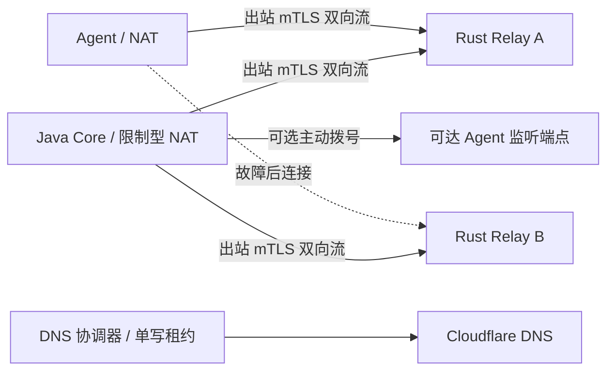

# 主控、Agent 双向通道与 Cloudflare DNS 故障切换

状态：已接受的目标设计，Relay 协议、Rust Relay、Core/Agent 长连接和 Cloudflare DNS 协调代码已实现首个闭环。Relay 通过 mTLS 接受 Agent 与 Core 出站双向流，按 Core cluster/epoch 和证书指纹路由；Rust Gateway 可并行预连接至少两个已配置 Relay，并在 Core 校验 Agent 心跳后开放该 Agent 的路由；Agent 可并行连接两个 Relay，按故障组独立轮换。Core epoch 由数据库单调递增分配，Relay 以权限受限的持久文件保存最高代际并拒绝旧 epoch。Core 的 DNS 协调器默认关闭；启用后只写配置 Zone 内受管后缀的 DNS-only CNAME，使用数据库租约、拒绝未登记或人工改动记录并在写后读回。Relay 健康与失败报告均需连续三次、至少间隔 8 秒；自动切换间设置 120 秒冷却，恢复后保持当前有效目标。Core Gateway 数据库 leader 租约、Agent 双 Relay 并行连接、安装时签名备用名单和记录恢复对账已实现；真实 Cloudflare DNS 传播/故障验收仍待实现。

## 1. 组件与连接方向

Core 保持 Java 21 / Quarkus JVM，负责任务授权、持久化、会话归属和 DNS 协调。部署在公网的 **Control Relay（主控代理）** 为独立普通用户 Rust 进程，接受 Core 和 Agent 的出站连接，承载控制面消息；不转发生产业务流量，也不取得 root Helper 能力。Core 内部 Agent Gateway 为逻辑协调职责，现有 Rust Gateway 为迁移起点，两者不可混称为已实现的公网代理。

| 模式 | 传输发起方与接收方 | 使用条件 |
| --- | --- | --- |
| Agent 主动直连 | Agent → Core 管理监听端点 | Core 可达，Agent 无需开放入站 |
| 主控主动直连 | Core → Agent 管理监听端点 | Agent 显式启用监听、网络可达且防火墙授权 |
| 代理汇聚 | Core → Relay；Agent → Relay | 双方均可仅有出站访问，Core 可位于限制型 NAT 后 |

三种模式建立后均为全双工长连接，Core 可主动下发任务，Agent 可主动上报事件、心跳和结果；拨号方向不限制消息方向。Core 通过已建立的代理通道主动发送任务，无需 NAT 入站映射。此方案依赖可用的出站 TCP/TLS 路径，不能保证在所有出口均被阻断时联网。

Core 持续连接至少两个独立故障域的 Relay；每条反向通道以 clusterId、coreId、relayId、sessionId 和租约代际登记。Relay 只有在 Core 反向通道有效且应用层路由探测成功时才可成为入口候选。Core 全部离线时，Relay 不得独立授权或执行任务。代理优先切换到其他有效 Core 通道；Core 多实例仍需数据库级任务领取和协调，代理不能代替主控高可用。

## 2. 通道协议、安全与恢复

基线为 TCP/443 上的 gRPC / HTTP/2 mTLS 双向流。主控主动连接 Agent 需要新增 Agent 监听服务和双向角色协商，不能直接反转当前只由 Agent 调用的 Session RPC。WebSocket/443 仅作为后续显式协商的兼容传输，不隐式降级认证。

连接握手协商协议版本、集群、节点角色、能力、最大帧和恢复游标。双方独立读写，心跳建议每 15 秒发送、连续 3 次无应用层响应进入 SUSPECT；连接建立与单次探测有独立截止时间。设有界发送队列、流控、消息大小和并发上限，慢连接不能无限占用内存。指标至少包括最后成功收发时间、重连次数、队列长度、代理路由可用性与 DNS 代际。

Relay 当前使用 mTLS 客户端 CA，并额外固定允许的 Core 证书 SHA-256 指纹；Relay 转发 Agent 客户端证书指纹，Core 通过现有心跳身份校验后才授权其控制路由。Core cluster ID、数据库分配的 epoch、Relay 持久 session fencing、64 KiB 帧上限、每流 8 项有界队列、最多 256 个 Agent 路由和限额控制消息已实现。Relay 终止各段 mTLS，因此属于受信传输组件；Core 对任务另行签署含目标、能力、有效期、operationId、幂等键和授权代际的信封仍待实现，Agent 现阶段继续依赖 Core API 授权、Agent 本地校验与 Helper allowlist。Relay 不持有任务签名私钥或 Cloudflare Token。证书吊销与轮换仍待实现。

会话采用递增 epoch / fencing token 选出一个任务投递主路径，其他连接作备用；双向同时拨号时按稳定节点身份排序和会话代际去重。消息含 messageId、序号与确认游标，任务状态持久化在 Core、执行去重状态持久化在 Agent。重连采用至少一次投递与结果对账，不承诺网络层恰好一次；超时未知任务先查询执行状态，禁止盲目重执行非幂等操作。心跳可合并，日志可限额丢弃并计数，任务与最终结果不得静默丢失。离线保留最后有效业务配置，重连不等于重新执行全部配置。

## 3. 每节点 DNS 与保留入口

以受管后缀 `k3s1.geekcorelab.com` 为例；它可以是 `geekcorelab.com` Zone 内的子树，不要求单独委派 Zone。

| 名称 | 含义与记录 |
| --- | --- |
| `xxx.k3s1.geekcorelab.com` | 节点唯一稳定名称；可达节点发布受管 A/AAAA，或指向受控可达入口的 CNAME |
| `relay-a.k3s1.geekcorelab.com` | Relay A 独立 A/AAAA；Relay B 使用独立名字和地址 |
| `api.k3s1.geekcorelab.com` | 保留的控制通道发现名；单一 CNAME 指向当前健康 Relay，例如 `relay-a.k3s1.geekcorelab.com` |

`api`、`relay-*` 及其他平台保留名禁止分配给普通节点。名称规范化为合法 DNS 标签，使用持久节点 ID 解决冲突，不随 hostname 修改而漂移。私网节点依然获得独立名称，但公网 DNS 不默认发布 RFC1918 地址；有受控 overlay 时可使用内部 DNS 视图，无可达地址时标记未发布。若节点名 CNAME 到 Relay，Relay 必须根据已认证 nodeId 路由，DNS 本身不会建立 NAT 穿透或开放该节点任意服务。

`api` 是管理通道入口，不自动成为 Web 控制台或 REST API 的反向代理。主控代理需持有该保留服务名的有效服务端证书，客户端随后验证集群身份；节点名称与证书身份分别管理。签发不得依赖仅能由故障主控完成的在线流程。

管理记录默认 `proxied=false`（DNS only），不假设 Cloudflare HTTP 代理可透明承载本方案 mTLS。CNAME 不与同名 A/AAAA 共存；目标 A/AAAA、CNAME 与负缓存 TTL 都影响恢复。建议 TTL 60 秒，实际采用账号/API 支持的最小值并读取核对；同 Zone CNAME 可能被 flatten 成最终地址，客户端必须支持直接 A/AAAA 回答，不能依赖观察到 CNAME 链来识别代理身份。

## 4. DNS 自动管理与代理接管

DNS 协调器是 Core 的 Java 控制面职责，使用仅对目标 Zone 授权的 DNS 编辑 Token；应用内再限制受管后缀、记录 ID 和所有权。Token 只从 Core 环境变量读取，不下发至 Agent/Relay。当前实现采用数据库单写租约与 epoch、每 20 秒协调、60 秒 TTL、`proxied=false`；Relay 状态必须至少连续三次、间隔不少于 8 秒上报健康后才能成为候选；当前目标出现失败报告时也需连续三次、间隔不少于 8 秒才允许切换，状态报告超过 35 秒即视为失鲜。每次自动目标变更至少冷却 120 秒，健康目标恢复后不自动抢回。协调器仅为 `api.<managed-suffix>` 和近期心跳主机的稳定 ID 名称写 CNAME；未配置候选时保留现有入口，不删除记录。检测非托管同名记录和人工修改冲突后停止覆盖，并在 Cloudflare API 写入后读回核对；每 20 秒重新读取期望与 Cloudflare 当前状态以恢复不完整写入。租约过期会停止后续写入，但 Cloudflare 更新不是基于本地 epoch 的原子 CAS，因此仍须限制 Token 和唯一有效写者。目标记录状态保存在 `dns_managed_record`；完整变更审计、重试/退避和计划切换仍未实现。

切换过程：

1. 综合 Core 反向通道心跳、Agent 侧失败及独立探测判定故障，避免单一监测点抖动误判；默认连续 3 次、至少间隔 8 秒的失败报告才切换；候选需连续 3 次成功。
2. 先确认备用 Relay 已有有效 Core 通道、证书和路由容量，再把 `api` CNAME 更新到该 Relay。无合格候选时告警并保持可解释的失败状态，不能指向无法接入 Core 的代理。
3. 写入后读回 Cloudflare API，并检查公共解析与真实 mTLS/任务往返；API 成功只代表记录写入，不代表全球缓存已更新。
4. 至少 120 秒冷却；当前目标恢复后不自动抢回。计划切换保留旧通道排空；故障切换依靠恢复游标对账，不宣称迁移已有 TCP 会话。

DNS 写入失败使用有界指数退避和抖动，尊重限流；不删除当前入口。Agent/Core 均保有预置及最近一次经 Core 签名确认的备用 Relay 名单，可不依赖 `api` 更新恢复连接。Core 本身也要刷新并连接候选，不能只让 Agent 切换。若 Core 全部离线，外部独立协调器需另行部署并取得同一单写租约才能代写；本方案不假设代理持有 DNS 凭据。

## 5. Agent 疑似网络故障时直查 Cloudflare

状态机：`CONNECTED → SUSPECT → RESOLVING → CONNECTING → RESUMING → CONNECTED`；失败进入带抖动的退避。触发包括连续心跳超时、EOF、连接超时和不可达；证书或授权拒绝单独报警，不通过反复换 IP 绕过验证。

1. SUSPECT 后启动一个合并恢复流程，保留仍能工作的旧连接，重新查询 `api.k3s1.geekcorelab.com` 的 A 和 AAAA。
2. 绕过系统及进程 DNS 缓存，直接向 `1.1.1.1`、`1.0.0.1` 查询：默认 UDP/53，截断时 TCP/53；总计最多 3 轮，两地址每轮各最多一次，每请求 2 秒超时，轮间 1、2 秒加随机抖动。每轮尝试新得到的可用地址，避免等待所有轮次后才连接。
3. 允许出口策略要求时配置 DoH：固定连接这两个 IP，HTTPS 使用 `cloudflare-dns.com` 的 SNI/Host 和正常证书校验，请求 `/dns-query`，不依赖本地 DNS 解析 DoH 端点；同一轮共享请求预算。不得自动绕过管理员限制或关闭 TLS 校验。
4. 支持 CNAME/flattening、A/AAAA、多地址和有界 CNAME 跳转；IPv4/IPv6 分别尝试。保留原始服务名作为连接校验名；DNS 缓存刷新不能改变身份信任。空回答、NXDOMAIN、SERVFAIL 和网络超时分别记录。
5. 全部失败后，尝试签名备用 Relay 名单与最后成功地址（仍须验证身份），随后按 1 秒起、上限 60 秒的指数退避加抖动继续恢复。新 DNS 查询遵守 TTL，单次故障流程限额，避免大规模 Agent 同时放大查询。

“最新”仅指此次直接询问公共递归解析器得到的回答，两个 IP 属于同一提供商，并非独立权威视角。直查不能强制清除 Cloudflare 递归缓存，也不能保证零传播延迟；必须依赖有界重试、备用地址和双代理预连接共同恢复。连接成功且完成身份、代际和任务游标确认后才标记恢复，TCP 建连成功不等于主控可用。

## 6. 分阶段实施与验收（部分实现，待完成）

- 协议阶段：双向 Relay RPC、Agent 入站流、Core 反向注册、Core 身份指纹授权、数据库 epoch/leader 租约和 Relay 持久 session fencing 已实现；任务签名信封、恢复游标和版本协商仍待实现。
- 连通阶段：覆盖 Agent 主动、Core 主动、双方同时拨号，以及双方位于限制型 NAT 且仅能出站到两个公网 Relay 的场景；验证双向独立主动发送、心跳与有界队列。
- DNS 阶段：测试每节点唯一名称、保留名拒绝、受管记录冲突、Token 最小权限、CNAME 切换及 flattening/AAAA/负缓存；在 Cloudflare 测试 Zone 验证，不能以 hosts/`--resolve` 代替传播验收。
- 故障阶段：停止当前 Relay、阻断单向流量、保留旧本地缓存、阻断一个公共解析地址及 UDP/53、模拟 Cloudflare API 限流和 Core 掉线；验证直查预算、备用通道、无 DNS 写入时恢复、冷却与无候选告警。
- 正确性与安全：验证重复任务不重复产生副作用、非幂等未知状态对账、旧 epoch 拒绝、伪造 DNS/证书/跨集群连接拒绝，以及断线期间业务数据面继续运行。
- 记录真实故障检测、DNS 可见、通道恢复和任务恢复耗时的 P50/P95；故障恢复预算包含检测时间、DNS 剩余 TTL、重连和对账，不承诺单靠 TTL 达到固定 SLA。

## 参考

- [Cloudflare DNS Records API](https://developers.cloudflare.com/api/resources/dns/subresources/records/)：记录读写和 TTL 参数。
- [Cloudflare CNAME flattening](https://developers.cloudflare.com/dns/cname-flattening/set-up-cname-flattening/)：同 Zone 目标可能 flatten。
- [Cloudflare 1.1.1.1 网络端点](https://developers.cloudflare.com/1.1.1.1/infrastructure/network-operators/)：公共解析 IP 和加密解析端点。
