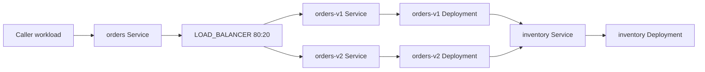

# Service network architecture

NaNPanel composes several network layers and keeps their ownership separate:

| Scope | Component | Responsibility | Evidence |
| --- | --- | --- | --- |
| Cross-host / NAT | NetBird Provider over WireGuard and Relay | Peer discovery, overlay addresses, and direct-versus-relayed path observations | Agent/Provider observations plus path probes |
| Kubernetes workload east-west | Optional Istio service mesh | Kubernetes Service/EndpointSlice discovery, workload identity, mTLS, and L7 policy | Kubernetes API and Istio proxy status/configuration |
| Internet edge | Envoy or FRP Provider | Public TLS endpoint, host/path routing, and explicit access policy | Provider state plus external TLS and HTTP probes |
| Platform control plane | Java Core and Agent Gateway | Desired state, authorization, operation lifecycle, and observation storage | PostgreSQL, audit events, and reconciled observations |

Istio is an optional service-network adapter for Kubernetes workloads. It does
not make a non-Kubernetes host part of the cluster mesh, create NAT traversal,
or replace NetBird. A host-side workload may reach a Kubernetes Service through
an authorized overlay or an explicit Gateway route; that cross-boundary path is
separate from in-mesh mTLS.

## Visual application traffic intent

The application canvas distinguishes three relationships:

| Relationship | Meaning | Example |
| --- | --- | --- |
| Resource binding | Kubernetes resource ownership or selector | Service selects a Deployment |
| Network link | L2/L3 reachability between device ports | Pod attachment to a virtual switch |
| Traffic flow | Application caller and destination route | Caller reaches a stable Service through a weighted backend policy |

A Service-to-Deployment selector line does not declare an application call, and
a virtual network wire does not choose a request's backend. A traffic flow
starts from a stable Service identity and port, can optionally name a caller
workload, and can pass through a `LOAD_BALANCER` whose outputs target logical
backend Services. Each output has a relative weight. Kubernetes
Service/EndpointSlice discovery supplies the Ready Pod endpoints for each
backend group, so the graph does not enumerate Pods. Separate Services identify
separate release groups when they need independent weights.

Deployments are full-duplex workloads. A Deployment may receive traffic through
one Service and initiate calls to other Services through separate flows. The
response path belongs to the original connection and does not need a reverse
edge. This keeps the app's server role separate from its client role.

For example, an orders Service can be the stable entry, with a weighted route
to version-specific Services. Each orders Deployment can then initiate a
separate call to the inventory Service:

The graph is declarative until a compatible route Provider binds it to a real
interception point and reports Apply/Verify state. A provider may use an
in-mesh proxy for east-west calls or a Gateway for ingress; supported
protocols and matches are provider capabilities. Direct Pod-IP traffic stays
outside a Service route unless a provider explicitly intercepts it. Multus and
the virtual L2/L3 graph can provide reachability or inspection, but do not infer
call relationships or execute relative backend weights. See [ADR-017](../adr/ADR-017-application-service-traffic-steering.md).

### Capturing a selected link

An operator should be able to start a temporary packet capture from a
supported canvas link, inspect its state, stop it, and download the resulting
PCAPNG file. This is a link action, not a new permanent route or a change to
forwarding. The capture record must identify the topology revision, selected
link, observation point and directions, filters, time bounds, and any
truncation. Sessions need duration and size bounds, an authorized operator,
and bounded artifact retention; exact defaults are still open.

The current Linux `PACKET_TAP` mirrors traffic from both business sides to its
monitor port with `tc mirred`, but it does not write a packet-capture file or
manage a capture session. A future recorder Provider must attach to that
mirror (or another verified packet source), report the coverage it actually
provides, and clean up temporary resources when capture stops. A logical
Service traffic-flow edge can offer capture only if its route Provider exposes
a real packet source. Request counters and proxy logs are observations, not
packet captures. A packet capture sees payload as it exists at that point;
traffic captured before TLS termination remains encrypted. Unsupported links
must show capture as unavailable rather than implying that a capture ran.

No throughput, latency, or traffic-split accuracy target is claimed before an
isolated data-plane experiment. Initial live acceptance must use an isolated
Kubernetes namespace and cluster, verify backend distribution and endpoint
updates, and verify compensation. Saving a graph or publishing control-plane
software does not install a mesh, Gateway, or CNI.

The test environment uses Istio 1.31.1 with K3s 1.33.5 in the isolated
`nanpanel-mesh` namespace. `PeerAuthentication` is STRICT and an
`AuthorizationPolicy` permits one named service account to call a fixture
service. The production `nanpanel` namespace remains outside the mesh until the
Provider can reconcile injection, health probes, Core-to-Agent Gateway
communication, and rollback safely. See [the test deployment](../../deploy/istio/README.md)
and [ADR-013](../adr/ADR-013-istio-service-network.md).

## Resource and endpoint mapping

The platform Service is the stable logical identity. An Endpoint maps that
identity to one concrete address and port with a source and observation time.
For Kubernetes, Service and EndpointSlice records are inventory inputs; Istio
does not replace them with a second platform registry. For non-Kubernetes
services, an Agent, overlay Provider, or gateway Provider supplies the endpoint
observation. Probe results are observations with a timestamp and generation,
not a mutation of desired topology.

`panel-cluster` reads Services and EndpointSlices in one explicitly chosen
namespace and emits a bounded snapshot with service ports, endpoint addresses,
readiness conditions, Pod target identity, and observation time. Core enriches
Pod endpoints with the live `istio-proxy` readiness and image version, including
both regular containers and Kubernetes native sidecars reported under
`initContainers`. For up
to 24 Ready sidecars per refresh, it reads the fixed private Pod address
`http://PodIP:15090/stats/prometheus` directly, without following redirects or
using a proxy. It accepts only destination-side `istio_requests_total` samples
whose destination Service belongs to the configured namespace and current
inventory. The stored flow rows contain source/destination workload names,
response code, reported `connection_security_policy`, and the Envoy request
counter. Principals, raw Prometheus labels, and unrelated metrics are discarded.
Each scrape has 500 ms connect/read timeouts and a 2 MiB response cap; larger
namespaces show partial sampling. Request counters are cumulative over the
sidecar lifetime, not a rate.

Core exposes the bounded read-only snapshot at
`GET /api/v1/kubernetes/service-inventory`; collection is disabled by default
and cluster/namespace identity comes from server configuration. Core persists
the latest snapshot and refreshes it every 60 seconds. The service-network UI
refuses to display mock inventory: Mock mode shows a live-connection prompt,
while connected mode shows compact service summaries with endpoints on demand
and actual Istio flow observations alongside the Service list. An independent,
disabled-by-default TCP probe switch can check at most 32 Ready EndpointSlice
private IP/TCP ports per refresh; it stores the latest result per
service/endpoint/port and prunes records after seven days. It skips FQDN, public,
loopback, link-local, UDP, and non-Ready endpoints. These TCP checks do not
represent Istio HTTP traffic or policy results.

The target `k3s-1` mesh was read-only verified to expose the metrics endpoint
from Core, report 200/mutual-TLS traffic for the allowed service account, and
report 403/mutual-TLS traffic for the denied identity. Production Istio policy
reconciliation remains future Provider work.

Path display must be based on provider evidence. A NetBird management API peer
record can establish discovery and control-plane connectivity, but does not by
itself prove whether a specific data path is direct or relayed. That path type
must come from the peer's local connection status or an equivalent provider
observation, and a successful probe must confirm the requested service path.
The isolated Istio fixture checks the Kubernetes-native mapping from its
Service port to a ready EndpointSlice Pod and performs allowed and denied HTTP
probes. P4 extends the persisted inventory with live proxy readiness/version
and bounded Envoy destination counters. These observations do not expose raw
Prometheus data or reconcile Istio policy; both HTTP policy configuration and
production injection remain Provider work.

The Agent can ingest optional NetBird loopback metrics as a timestamped host
summary (known, connected, P2P, and relayed peer counts). When the root Helper
finds a trusted NetBird CLI, it also reads `netbird status --json`, reduces the
result to peer FQDN, connection status, and P2P/Relay type, and reports a
timestamped per-peer snapshot through Core to the console. Addresses, keys, and
relay endpoints are discarded. This remains read-only Agent inventory.

Core also loads the first-party PF4J NetBird Provider when explicitly enabled.
It reconciles membership only for dedicated groups under a configured managed
prefix, persists operation plans and stages, audits changes, and checks live
fingerprints before apply, verification, and compensation. Core can restore the
provider's ephemeral operation context after restart only when live membership
and preserved group resources match the persisted plan. This Provider does not
manage NetBird policies, routes, or peer enrollment; its local HTTP-fixture
tests are supplemented by a live disposable-tenant run that reconciled one
connected peer and verified restart recovery and compensation. See the
[live acceptance record](../../tests/p2/runs/2026-10-20-netbird-provider-live.md)
and [Provider contract and configuration](../../plugins/provider-netbird/README.md).

A disposable cross-host lab verified P2P → Relay → P2P with an HTTP request at
each stage for one public-host Docker-to-K3s topology; see the
[acceptance record](../../tests/p2/runs/2026-10-20-netbird-successful-path-switch.md).
Keep Agent observations separate from NetBird Provider group state and from
application health checks.

## Reconciliation boundary

The NetBird Provider currently manages membership in dedicated groups. Future
Istio and Envoy/FRP Providers can map desired services, endpoints, routes, and
security policies to their external systems. They report `planned`, `applied`,
`verified`, `degraded`, or `unsupported` observations. NetBird owns overlay transport;
Istio owns in-mesh workload identity and traffic policy; Envoy/FRP owns public
ingress. The Core must reject conflicting ownership and preserve resources it
does not manage. A gateway switch is committed only after the new path passes
identity validation and an application-level probe; otherwise compensate to the
last verified route.

The NetBird managed-group Provider and Core operation lifecycle have local
HTTP-fixture coverage, and the Provider has passed live disposable-tenant
membership reconciliation. Authenticated Core inventory and probe API
responses have now passed against the target cluster using a scoped,
revocable read-only API key; the timestamp precision fix and live response
evidence are recorded in
`tests/p2/runs/2026-10-20-core-service-probe-live.md`. Production gateway
reconciliation and Istio policy reconciliation remain later Provider work;
the P2 public ingress and gateway recovery evidence is recorded in
`tests/p2/README.md`.
